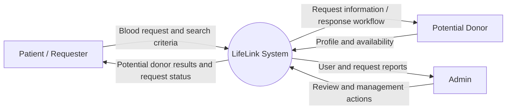
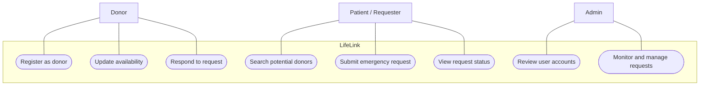
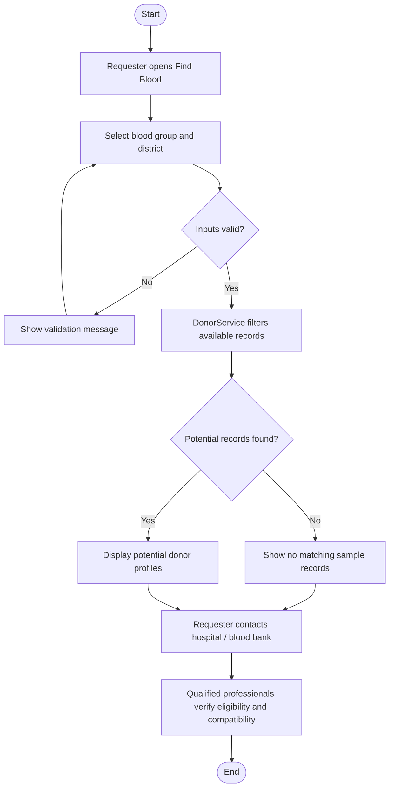
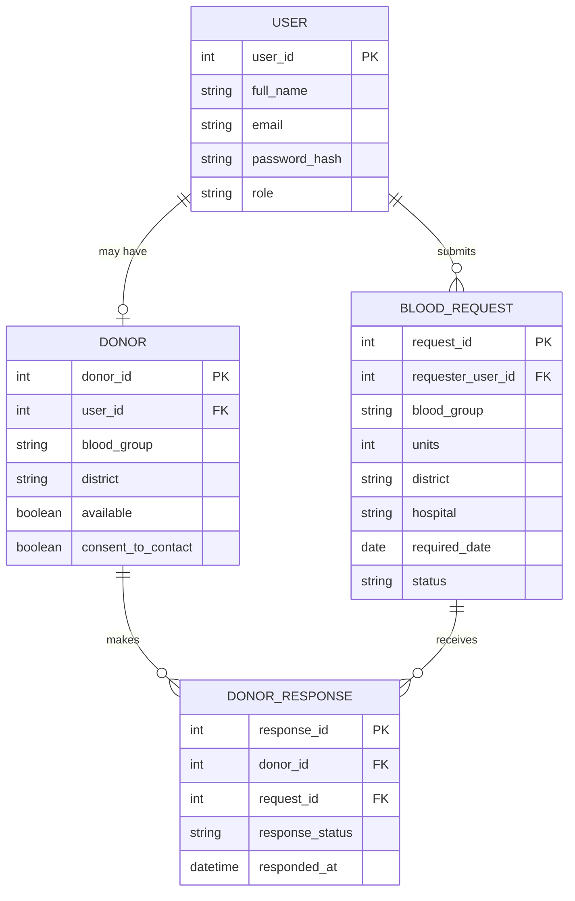
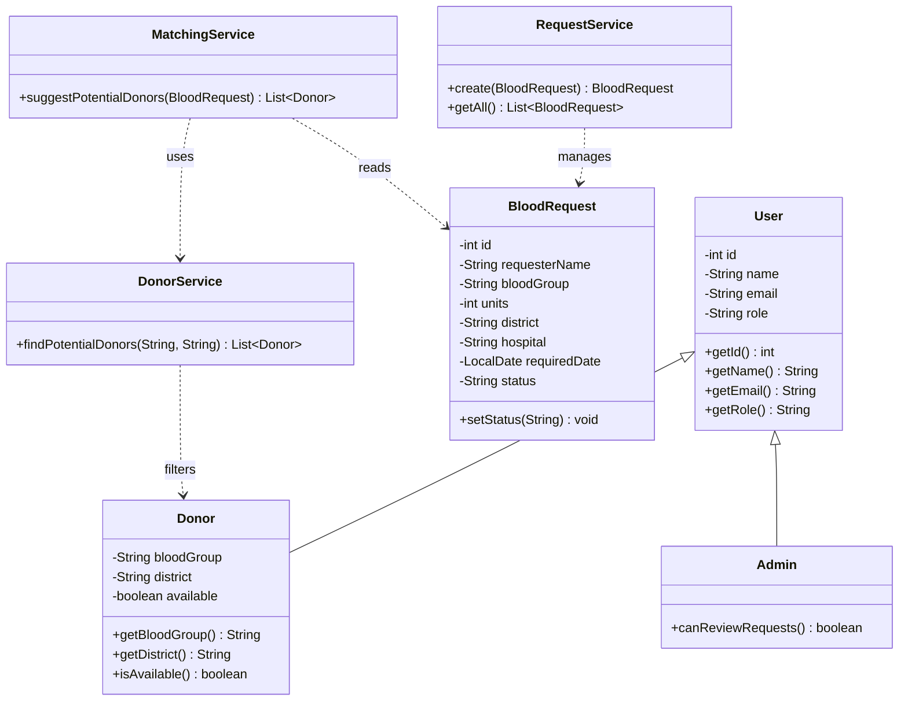
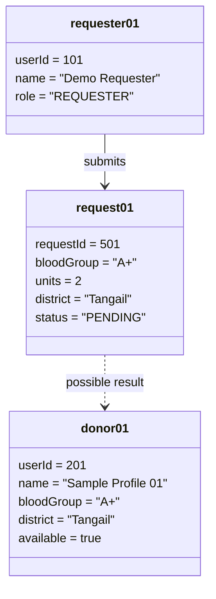
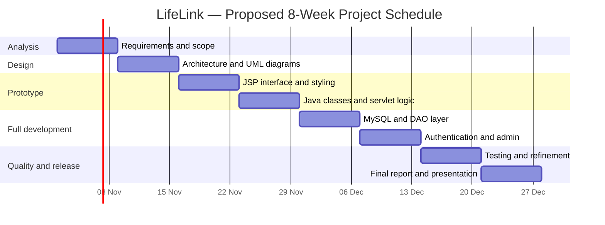

# LifeLink
## Intelligent Emergency Blood Donor Matching & Management System
### Capstone Project Proposal and Initial Prototype

**Project type:** Individual academic software project  
**Proposed domain:** Healthcare support / social good  
**Proposed process model:** Incremental development with Agile iterations  
**Technology:** Java (developed using JDK 25; project source compatibility is currently set to Java 17), JSP, Jakarta Servlet 6.0.0, HTML, CSS, JavaScript, Maven and Apache Tomcat 10.1; MySQL is planned for the database-backed phase  
**Student:** Rina Akter  
**Student ID:** IT24036  
**Department:** ICT Department, MBSTU  
**Course:** 3108 — Software Engineering and Project Management Lab  
**Supervisor:** Ziaur Rahman  
**GitHub repository:** https://github.com/RiNa-036/Software-Engineering-and-Project-Management/tree/main/Project

---

## 1. Executive Summary
LifeLink is a proposed web-based platform that aims to make the search for potential blood donors more organized during urgent blood requirements. A requester will be able to submit a blood request and search potential donors using blood group and location. A donor will be able to create a profile and update availability. An administrator will be able to review user accounts and monitor requests.

The project addresses an information-coordination problem: donor information may be scattered across personal contacts and social media, making it difficult to organize a search. LifeLink proposes a centralized workflow for recording requests and finding potential donor contacts.

The initial prototype demonstrates the main user interface and Java-based donor filtering/request handling. The current prototype uses fictional sample records and in-memory data only. It is not a live blood service, does not contact real donors, and does not make medical decisions. Database persistence, authentication, verification and AI-assisted recommendations are future development stages.

## 2. Introduction and Background
Blood transfusion services depend on safe donor selection, screening and compatibility testing. During a time-sensitive need, families may also face difficulty locating potential donor contacts. A software platform can help organize donor information and requests, but it must not replace hospitals, blood banks or qualified medical professionals.

LifeLink focuses on the software coordination layer: donor registration, request submission, location-based filtering, request tracking and administrative monitoring.

## 3. Problem Statement
Potential blood donor information is often distributed across separate communication channels. Requesters may have to repeat the same information to multiple people and manually organize responses. There is a need for a structured digital workflow that can help users search potential donor records and manage request information in one place.

## 4. Aim and Objectives
### Aim
To design and prototype a web-based system that organizes potential blood donor discovery and emergency blood request management.

### Specific objectives
1. Provide a structured registration interface for potential donors.
2. Allow requesters to search potential donor records by blood group and district.
3. Provide a form to submit an emergency blood requirement.
4. Support donor availability information.
5. Provide an administrative workflow for account/request monitoring in the planned full system.
6. Design a maintainable object-oriented architecture using Java classes.
7. Explore AI-assisted donor recommendation only as a future enhancement after reliable data and safety controls are available.

## 5. Scope
### In scope
- Donor profile data model.
- Blood request data model.
- Blood group and district filtering.
- Donor availability flag.
- Request submission workflow.
- Role concepts: Donor, Requester and Admin.
- Admin review/monitoring in the planned full system.
- Responsive web interface.
- UML and project planning documentation.

### Out of scope for the initial prototype
- Real donor registration or contact.
- SMS, email or push notifications.
- Live GPS tracking or distance calculation.
- Medical eligibility assessment.
- Clinical compatibility/crossmatching.
- Payment or blood sales.
- Hospital integration.
- AI model integration.
- Production deployment and handling real patient data.

## 6. Stakeholders and User Roles
| Stakeholder | Responsibilities |
|---|---|
| Donor | Create a potential donor profile, specify blood group/district and availability, respond to requests in the future full system. |
| Patient / Requester | Search potential donors and submit a blood requirement with hospital/location details. |
| Admin | Review reported or incomplete accounts, monitor requests, manage misuse and maintain system records. Admin does not make clinical decisions. |
| Hospital / Blood bank | Performs professional donor assessment, blood grouping, screening and crossmatching outside the app. |
| Project supervisor | Reviews scope, design, implementation and academic deliverables. |

## 7. Functional Requirements
| ID | Requirement | Priority |
|---|---|---|
| FR-01 | The system shall display project information and navigation. | Must |
| FR-02 | A donor shall be able to enter a donor profile. | Must |
| FR-03 | A requester shall be able to select a required blood group. | Must |
| FR-04 | A requester shall be able to select or enter a district. | Must |
| FR-05 | The system shall filter available potential donor records by blood group and district. | Must |
| FR-06 | A requester shall be able to submit an emergency request. | Must |
| FR-07 | The system shall validate required form fields. | Must |
| FR-08 | A donor shall be able to update availability in the full system. | Should |
| FR-09 | An admin shall be able to review users and requests in the full system. | Should |
| FR-10 | The system may provide AI-assisted recommendations in a later version. | Could |

## 8. Non-Functional Requirements
- **Usability:** Clear labels, simple navigation and responsive layout.
- **Performance:** Search should return results promptly for the expected academic dataset.
- **Maintainability:** Separate model, service and web/controller layers.
- **Security:** A production version must use password hashing, authorization, input validation, HTTPS and secure session handling.
- **Privacy:** Collect only necessary information, obtain consent and restrict access to personal contact details.
- **Reliability:** Validate data and handle invalid or missing inputs gracefully.
- **Compatibility:** Support modern desktop and mobile browsers.
- **Safety:** Results are potential contacts only; clinical screening and compatibility checks remain the responsibility of qualified professionals.

## 9. Proposed Software Process Model
### Incremental Model with Agile Iterations
The project will be developed in small increments. Each iteration will produce a reviewable feature set. This is suitable because the project has a clear initial scope but additional features (database, authentication, verification and optional AI) can be added after feedback.

| Iteration | Work | Output |
|---|---|---|
| 1. Planning | Identify problem, users, scope and requirements. | Approved proposal and requirements list |
| 2. Design | Prepare DFD, Use Case, Activity, ER, Class and Object diagrams; design UI. | UML/design package |
| 3. Prototype | Build JSP pages and Java model/service classes. | Initial working prototype |
| 4. Data layer | Add MySQL schema, DAO and persistent records. | Database-backed version |
| 5. Access control | Add login, roles, validation and admin workflow. | Role-based application |
| 6. Testing & release | Functional, integration, usability and security checks; documentation. | Final release candidate |

## 10. System Architecture
The planned architecture follows a simple MVC/service separation:

1. **Presentation layer:** JSP, HTML, CSS and JavaScript pages.
2. **Controller layer:** Jakarta Servlets receive requests, validate inputs and select responses.
3. **Service layer:** DonorService, RequestService and MatchingService contain application logic.
4. **Model layer:** User, Donor, Admin and BloodRequest represent domain objects.
5. **Data layer (future):** DAO classes and MySQL database will persist users, donors and requests.

The initial prototype uses in-memory demonstration records. It does not yet use MySQL.

## 11. UML and System Diagrams
The Mermaid source for each diagram is also supplied separately in `docs/diagrams/`. GitHub can render Mermaid in Markdown previews.

### 11.1 Data Flow Diagram (DFD — Context Level)

### 11.2 Use Case Diagram

### 11.3 Activity Diagram — Emergency Donor Search

### 11.4 Entity Relationship Diagram (ERD — Planned Database)

### 11.5 Class Diagram

### 11.6 Object Diagram — Example Runtime Snapshot

*All names and records in this object diagram are fictional demonstration data.*

## 12. Project Schedule, Milestones and Deliverables
The schedule below is a proposed 8-week plan. Replace the week labels with actual calendar dates agreed with the supervisor.

| Week | Activities | Milestone | Deliverable |
|---|---|---|---|
| 1 | Problem analysis, stakeholder identification, requirements | M1: Scope approved | Proposal and SRS |
| 2 | Process model, architecture and UML diagrams | M2: Design approved | DFD, Use Case, Activity, ERD, Class and Object diagrams |
| 3 | UI wireframes and JSP/CSS implementation | M3: UI prototype ready | Home, Find Blood, Donor Registration and Emergency Request pages |
| 4 | Java model and service classes; servlet integration | M4: Core prototype ready | Java classes and working search/request demo |
| 5 | MySQL schema, DAO and persistence | M5: Data layer ready | Database scripts and CRUD operations |
| 6 | Authentication, role-based access and admin workflow | M6: Main features integrated | Donor/requester/admin workflows |
| 7 | Testing, bug fixing, usability and safety review | M7: Testing completed | Test report and corrected build |
| 8 | Final documentation, screenshots and presentation | M8: Final submission | Final application, report, GitHub repository and demo |

### Gantt Chart

## 13. Testing Strategy
| Test ID | Test case | Expected result |
|---|---|---|
| TC-01 | Open home page | Homepage loads and navigation is visible |
| TC-02 | Search by A+ and Tangail | Only available sample A+/Tangail profile is shown |
| TC-03 | Search with no matching district/group | Empty-result message is shown |
| TC-04 | Submit request with missing required field | Browser/server validation prevents invalid submission |
| TC-05 | Submit valid demonstration request | Confirmation page is displayed |
| TC-06 | Open pages on mobile viewport | Layout adapts without horizontal overflow |
| TC-07 | Try to treat sample profiles as real donors | Demo warning is clearly visible |

## 14. Risk Analysis and Mitigation
| Risk | Impact | Mitigation |
|---|---|---|
| Incorrect or outdated donor details | High | Require consent, availability updates and verification in production |
| Privacy exposure | High | Minimize collected data, role-based access, secure storage and consent |
| User assumes search result is medically compatible | Critical | Clearly label results as potential contacts; require professional screening/crossmatching |
| Fake or abusive accounts | Medium | Admin review, reporting and verification workflow |
| Scope expansion | Medium | Deliver features incrementally; keep AI and integrations out of initial prototype |
| Limited development time | Medium | Prioritize core workflow and document future features honestly |

## 15. Ethical, Legal and Safety Considerations
LifeLink will not sell blood or guarantee a donor. It will not recommend transfusion or declare medical compatibility. Donor eligibility, blood grouping, infection screening and crossmatching must be performed by qualified professionals at an authorized facility. A production system must obtain informed consent, protect personal information, provide account deletion/correction mechanisms and comply with applicable Bangladesh laws and institutional policies.

## 16. Future Enhancements
- MySQL-backed persistent storage.
- Secure login and role-based authorization.
- Donor availability updates and request responses.
- Admin verification and audit logs.
- Location distance ranking using reliable geographic data.
- SMS/email notifications with consent.
- AI-assisted ranking or prioritization with explainable criteria and human oversight. AI will not determine clinical eligibility or compatibility.

## 17. Current Prototype Status
The initial prototype includes the homepage, potential donor search page, donor registration form and emergency request form. Java classes include `User`, `Donor`, `Admin`, `BloodRequest`, `DonorService`, `RequestService` and `MatchingService`, with servlet controllers for donor search and request submission. The donor search and request submission use in-memory demonstration data. Data is lost when the application restarts. Donor registration is currently a UI demonstration and is not persisted.

**This is a prototype, not a deployed public service.** The GitHub repository link above points to the Project folder containing the submitted project materials. The source-code repository is provided above. A separate running demo URL should be added only after deployment to a Java-supporting host.

## 18. References
1. Sommerville, I. *Software Engineering*. Pearson.
2. Pressman, R. S., and Maxim, B. *Software Engineering: A Practitioner's Approach*. McGraw-Hill.
3. Object Management Group. *Unified Modeling Language (UML) Specification*. https://www.omg.org/spec/UML/
4. Oracle. *Java Documentation*. https://docs.oracle.com/en/java/
5. Apache Tomcat. *Tomcat 10.1 Documentation*. https://tomcat.apache.org/tomcat-10.1-doc/
6. Directorate General of Health Services, Bangladesh. Safe blood transfusion guidance and relevant national procedures should be consulted during any real-world deployment.
